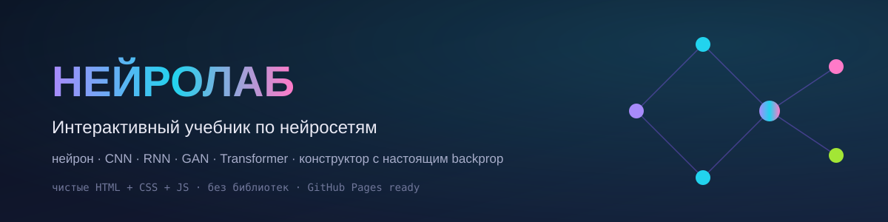

# НейроЛаб — интерактивный учебник по нейросетям

**Понятно с нуля. Красиво. Всё считается честно, прямо в браузере.**

Чистые HTML + CSS + JavaScript · ни одной библиотеки · ни одного запроса к серверу · готов к GitHub Pages

---

## 📖 О проекте

**НейроЛаб** — это одностраничный обучающий сайт, который проводит человека с нулевыми знаниями от одного искусственного нейрона до архитектуры ChatGPT, Claude и Qwen. Каждая глава сопровождается **живой интерактивной демонстрацией**: не видео и не заготовленные анимации, а настоящие вычисления — градиентный спуск, свёртка, рекуррентное состояние, состязательное обучение GAN и сэмплирование токенов выполняются на устройстве читателя в реальном времени.

Финал — **песочница-конструктор**: собери многослойный перцептрон, выбери логическую задачу (OR / AND / XOR), настрой гиперпараметры и наблюдай, как сеть учится: веса на связях, активации нейронов, падающая ошибка, таблица истинности и график loss.

## 🗺️ Содержание сайта

| # | Глава | Что объясняется | Интерактив |
|---|-------|-----------------|------------|
| 01 | **Основы** | Нейрон, слой, вес, смещение, функция активации, зачем нелинейность и глубина | Живой нейрон: ползунки входов/весов/bias, 4 активации, график f(z), пресеты И / ИЛИ / НЕ (перцептрон 1958 года) |
| 02 | **Типы нейросетей** | MLP, CNN, RNN/LSTM, Transformer, GAN, автоэнкодеры, диффузия, RL — для чего каждый и где применяется | Карта архитектур с фильтром по задачам (текст / картинки / звук / генерация / таблицы / игры) |
| 03 | **Обучение** | С учителем, без учителя, self-supervised, RL; loss, градиентный спуск, backprop по шагам, эпохи, батчи, переобучение | Два демо: линейный классификатор учит границу решений (настоящий SGD) и k-means кластеризует точки без меток |
| 04 | **CNN** | Свёртка, разделение весов, ядра, stride, pooling, иерархия признаков, история LeNet → ConvNeXt | Ядро 3×3 ползёт по картинке 32×32, карта признаков строится вживую; 5 ядер, MaxPooling, инспекция окна, **кисть — рисуй своё изображение** |
| 05 | **RNN** | Скрытое состояние как память, формула hₜ, развёртка, затухающий контекст, LSTM/GRU, почему победил Transformer | Сеть читает отзыв по словам: 4 нейрона памяти анимируются, «лента памяти» показывает затухание ранних слов, вердикт тона |
| 06 | **GAN** | Генератор vs дискриминатор, цикл тренировки, non-saturating loss, mode collapse, применение | **Настоящий мини-GAN** (G: 2→12→12→2, D: 2→16→16→1) учит кольцо / луны / квадрат из шума; фон — мнение дискриминатора, графики loss обеих сетей |
| 07 | **LLM / Transformer** | Токены, эмбеддинги, RoPE, Q·K·V-внимание, multi-head, FFN, decoder-only, авторегрессия, предобучение → SFT → RLHF, MoE, KV-кэш, галлюцинации; таблица моделей (GPT, Claude, Qwen, Gemini, Llama, DeepSeek, Mistral) | Три вкладки: живой токенизатор, кликабельная матрица внимания («он» → «Кот»), генерация с **настоящим softmax и температурой** |
| 08 | **Песочница** | Практика: архитектура, гиперпараметры, линейная неразделимость XOR | Конструктор MLP (см. ниже) |
| 09 | **Проверь себя** | Закрепление | Тест из 7 вопросов с объяснениями + карманный словарь + ссылки для дальнейшего роста |

## 🧪 Песочница-конструктор — подробнее

Задача сети: на вход подаются три бита **A, B, C** (каждый 0 или 1), четвёртый «вход» — выбор логической операции **OR / AND / XOR**. Сеть должна выдавать правильный бит для всех **8 комбинаций** (таблица истинности видна рядом и обновляется вживую).

Что можно менять — всё применяется мгновенно:

- **Операция**: OR, AND, XOR (XOR трёх бит — чётность);
- **Число скрытых слоёв**: 0–4;
- **Нейроны в каждом слое отдельно**: 1–8 (индивидуальные степперы на каждый слой);
- **Активация**: tanh / сигмоида / ReLU (с честным предупреждением про «умирающий ReLU»);
- **Learning rate**: 0.02–1.0;
- **Скорость**: 1–60 эпох за кадр;
- **Текущий вход A, B, C**: переключатели — сигнал с этими значениями течёт по схеме; можно также кликнуть любую строку таблицы истинности;
- **Подписи весов** на связях, **hover-инспекция** любого веса и нейрона (значение активации и bias);
- **Пресеты**: «XOR · быстро», «Глубокая 3×4», «Без слоёв (провал)» — последний наглядно демонстрирует проблему Минского 1969 года;
- **Экспорт модели в JSON**: архитектура, все веса, смещения, метрики и предсказания.

Визуализация: толщина связи = |вес|, цвет = знак (голубой «+», розовый «−»), яркость нейрона = активация, импульсы бегут по связям, при 8/8 — салют частиц. Умные подсказки реагируют на ситуацию: «XOR без скрытого слоя обречён», «плато — смени lr или активацию», «решено за N эпох».

Под капотом — собственный движок `js/lib/nn.js`: полный батч из 8 примеров за эпоху, сигмоида на выходе, бинарная кросс-энтропия, backprop по правилу цепочки, чистый SGD. Никакой имитации.

## 🛠️ Технологии и принципы

- **Vanilla JS (ES-модули)** — без фреймворков, сборщиков и зависимостей;
- **Canvas 2D** для всех визуализаций: DPI capped ×2, один `requestAnimationFrame` на демо, автопауза вне экрана (IntersectionObserver);
- **Собственный MLP-движок** (~120 строк) — переиспользуется классификатором, GAN и песочницей;
- **Тёмная дизайн-система**: фиолетово-циан-маджента палитра, у каждой главы свой акцентный hue, аврора-фон, зерно, кастомный скроллбар;
- **Адаптив**: десктоп / планшет / мобильный (бургер-меню, перестройка сеток, стекинг панелей);
- **Доступность**: семантика, aria-подписи канвасов, focus-visible, `prefers-reduced-motion`;
- **Шрифты**: Unbounded + Manrope + JetBrains Mono (Google Fonts, все с кириллицей; при офлайне — системные фолбэки).

## 📁 Структура проекта
